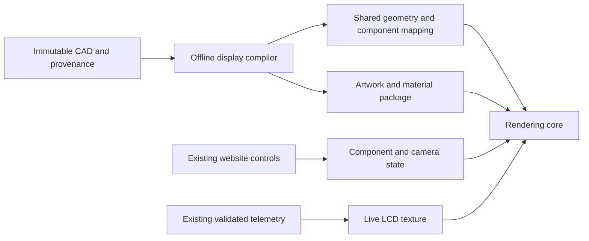

# Knight EPS: architecture reset and feasibility plan

10 November 2026. Research, source inspection and an offline asset audit only. Implementation and model assets have not been edited by this review. This document supersedes the narrower next-step recommendation in `../twin-renderer-feasibility-20261109/PLAN.md`; that report remains useful supporting evidence.

## Recommendation

**Stop incremental optimization of the current Studio path. Design a new rendering core and offline display-model pipeline, preserving the website layout and telemetry boundary. Prove the complete assembly on this 2018 MacBook Pro before committing to the rebuild.**

Starting again can remove accumulated assumptions. It does not establish that an equivalent image will reach 60 fps. The strongest candidate is a prepared CAD display representation feeding a renderer that shades opaque geometry once and reuses that image for acrylic refraction. Use a maintained Three.js pipeline first; write custom rendering only if a specific measured limitation warrants it.

The earlier work is evidence, not a reason to retain its architecture. Demand rendering, stable component IDs, original CAD provenance and telemetry validation remain valuable. Runtime geometry rebuilding and the existing material/pass arrangement need not survive.

## What the evidence establishes

The target is the user's MacBookPro15,2: Intel i5-8259U, Iris Plus 655 and 8 GiB shared system RAM. A stronger computer passing would not meet this target. Previous browser evidence identifies ANGLE Metal on that GPU, rather than a software renderer. Native-browser, thermal and compositor effects remain unresolved.

| Finding | Evidence and implication |
| --- | --- |
| Studio remains far from 60 fps | Matched optimization reduced orbit draws 985 → 395 and CPU submission about 22.5 → 9 ms; GPU remained around 51 ms. The texture subset reached about 46 ms GPU. A 14 ms GPU headroom target needs roughly 3.3–3.6× improvement from those observations. This ratio is a requirement, not an achievable speedup prediction. |
| Repeated opaque rendering is real | Vendored `three.module.js:16464` renders opaque objects into a full-resolution, mipmapped, four-sample transmission target. Main-scene rendering draws them again. Removing that replay is relevant, but its exact isolated GPU cost was not measured successfully. |
| Artwork is expensive in storage despite tiny geometry | New audit: fifteen PCB images occupy approximately **658.42 MiB** as RGBA8 with complete mip chains. They map onto fifteen unique two-triangle planes, instanced as eighteen planes / **36 logical triangles**. Active textures including the LCD were estimated at 660.69 MiB in the delivery study. Geometry complexity and texture cost are very different here. |
| Copper alpha has meaning | Each top-copper image contains alpha values 0 and 205; each bottom-copper image contains 0 and 190. Silkscreen uses 0 and 255 at source mip zero. Therefore a blanket BLEND → MASK conversion changes copper appearance. Filtering also creates intermediate edge alpha. |
| Much artwork is sparse | Bottom-copper nonzero coverage ranges approximately 0.78–5.71%; silkscreen 1.65–2.92%. Light-sensor top copper is 3.44%; other top maps approximately 70.68–81.67%. These percentages describe source pixels, not measured screen overdraw or GPU savings. |
| The current viewer treats board-sized planes as transparent surfaces | Ten unique copper materials are BLEND; five silkscreens are MASK. Their planes are double-sided. They deserve a surface-appearance design review, rather than assuming a general transparent-object path is necessary. |
| Geometry is already shared in the source | 874,229 logical triangles versus 786,749 triangles across unique meshes. The compiler shares regulator meshes. Runtime consolidation clones candidates independently per component, so compatible regulator opaque geometry is rebuilt separately. Move preparation offline and preserve sharing explicitly. |
| Small geometry fixes are secondary | A lossless Uint32 → Uint16 opportunity exists for eligible independent primitive indices: 2,434,548 bytes (2.32 MiB). Useful compiler hygiene; not a credible explanation for the entire frame-time gap. |
| Lifecycle needs explicit ownership | `main.mjs:204` disposes geometry and materials but does not explicitly dispose model textures or close owned ImageBitmaps. Consolidation removes original meshes without an ownership registry. This is a cleanup/design concern; no repeated-load leak magnitude was measured. Material disposal alone does not dispose textures. [Three.js disposal guidance](https://threejs.org/manual/pages/how-to-dispose-of-objects.html). |

Source model SHA-256 remains `dee1eeb8d43504350bf0c34fc8eff95210aa505eec6ff0da168c6f740c803f47`. `audit-assets.py` and `asset-audit.json` make the new findings reproducible. The audit reads the GLB and writes only evidence here. No new rendering benchmark was run.

The GPU constrains the budget, but blaming its age would stop the investigation too early. We have established that the current workload exceeds its budget. We have not established that the desired result intrinsically does.

## What Autodesk Viewer teaches us

The reference is [Autodesk Viewer](https://viewer.autodesk.com/). Autodesk confirms that this site and its other viewing products use the Viewer SDK. Its free website uses manual upload/translation and does not expose programmatic access to that website workflow. Embedding its SDK is a separate option. [Autodesk's viewing-product explanation](https://aps.autodesk.com/blog/different-ways-viewing-design-models).

Relevant documented mechanisms:

- **Prepare a viewing representation:** SVF2 shares meshes within and across viewables. Stable external identifiers matter when generated object IDs change. This supports separating source CAD from browser representation. It does not establish a speedup for this model. [SVF2 production announcement, 2021](https://aps.autodesk.com/blog/update-svf2-ga-new-streaming-web-format-forge-viewer-now-production-ready).
- **Batch with spatial awareness:** Autodesk's 2024 Smooth Navigation description combines size/spatial grouping and hierarchical detail. Its historical 2016 consolidation article also documents the memory, animation and culling costs of merging. Copying “merge everything” would miss those tradeoffs. Neither article proves the current website's exact configuration. [Smooth Navigation](https://aps.autodesk.com/blog/viewer-performance-update-part-3-3-smooth-navigation), [historical consolidation design](https://aps.autodesk.com/blog/forge-viewer-consolidated-geometry).
- **Distinguish navigation from complete-frame quality:** Viewer settings expose progressive display, target frame rate and an option to disable shadow effects during navigation. These are available strategies; we have not verified which settings were active in the user's experience. A smooth progressive view is not automatically a complete Studio frame at 60 fps. [Current Viewer settings](https://help.autodesk.com/cloudhelp/ENU/ADSKVIEWER-Help/files/AutodeskViewerTools/ADSKVIEWER_Help_AutodeskViewerTools_ViewerSettings_html.html).
- **Separate component ownership from draw instances:** Autodesk's new Scene API models logical objects separately from geometry/material/transform instances. It also supports dynamic models without an upload, translation job or URN. Thus an Autodesk SDK alternative cannot fairly be rejected solely because of cloud translation. Its documented material set still needs qualification against our acrylic and LCD requirements. [Scene API introduction, August 2026](https://aps.autodesk.com/blog/introducing-scene-api-aps-viewer).
- **Keep backend/version distinctions explicit:** APS Viewer v8 is currently a preview, announced October 30, 2026, built around WebGPU and the Large Model Experience with a WebGL fallback. It is not evidence that `viewer.autodesk.com` is running that version, nor that this Mac uses WebGPU. [v8 announcement](https://aps.autodesk.com/blog/aps-viewer-v8-preview-here).

We have not viewed the same assembly inside Autodesk, inspected its settings or timed it on this machine. The public landing page returned a browser-support message to the research reader. No project asset was uploaded. Autodesk's result is a useful product reference and architectural lead; an apples-to-apples performance claim remains unverified.

## Proposed architecture

### 1. Compile for display; retain canonical CAD

Keep original exports, accurate transforms, units, source hashes and all 95 component identities as the authority. Generate a separately versioned display package with an explicit component-to-draw mapping. Do not overwrite `KnightEPS_Detailed.glb` or rerun the production compiler during the proof.

Precompute compatible material batches, immutable shared geometry, bounds and ownership offline. Preserve repeated regulator geometry across instances. Keep animated components independently addressable; do not combine lid/body/fixtures into an inseparable mesh. A material group still incurs a draw. Avoid a giant atlas or a single assembly mesh merely to reduce object counts.

The initial representation preserves all 874,229 logical triangles and exact attributes/transforms. No decimation, normal-map substitution, quantization or reduced-geometry LOD is included. Use narrow indices only when their maximum referenced index fits; do not split geometry solely for this small saving.

### 2. Treat printed artwork as a surface-design problem

Evaluate a board-face material that uses the original artwork and its alpha to describe the substrate surface, instead of stacking large general-purpose transparent planes. Preserve source texels, UV alignment, legibility, color space, ordering and both faces. Classify substrate, copper, silkscreen and physical components separately.

This is a hypothesis, not an already equivalent conversion. Separate layers have lighting, depth and parallax behavior; compositing RGB values offline cannot automatically reproduce that behavior. Holes, pads, grazing angles and the approximately 65 µm copper-to-silkscreen offsets require explicit inspection. A custom shader may cost more than expected.

The strict control retains every plane and material. A second, separately labeled candidate may represent the 36 auxiliary artwork-carrier triangles through board-face shading while retaining them in canonical data. **That render-representation change needs explicit approval. It is not implied by retaining CAD files.** No physical CAD surface, component or artwork detail may disappear. If fidelity fails, retain the original layered representation and report the performance consequence.

Use original PNGs first to isolate representation changes. Only then qualify full-size GPU-compressed artwork as an independent memory change. Reuse the regulator UASTC/BC7 evidence; validate every remaining board, mip chain, alpha edge and actual device transcode format. Several source heights are not multiples of four; block-format legality, padding, UV mapping and mip bleed must be resolved without silent resampling. The dynamic LCD remains a canvas texture. Do not promise that compressing every map is lossless or that storage savings equal frame-time savings.

### 3. Shade opaque geometry once; retain polished acrylic

The first maintained candidate is the same-release r176 Three.js node renderer, tested with its WebGL2 backend and actual hardware WebGPU where available. Its viewport-texture path copies the framebuffer for transmission, offering a route around legacy opaque-scene replay. Full-size copies, mipmaps, MSAA resolves and intermediate targets still cost bandwidth. Different shader implementations require image review. [Pinned r176 viewport-texture source](https://raw.githubusercontent.com/mrdoob/three.js/r176/src/nodes/display/ViewportTextureNode.js), [physical-lighting source](https://raw.githubusercontent.com/mrdoob/three.js/r176/src/nodes/functions/PhysicalLightingModel.js).

Target a clear pass structure: cached shadows when valid; opaque surface rendering; the minimum required full-resolution transmission image preparation; correctly ordered acrylic/transparent content; output conversion. Do not replace acrylic with tinted opacity or cache a stale refraction image during orbit. Preserve environment response, soft shadows, full drawing-buffer resolution and equivalent antialiasing.

Use a consistent r176 module graph and a small renderer adapter. Per-light shadow invalidation, environment preparation, counters, resize, capture and resource cleanup are adapter responsibilities. A newer Three.js version is justified only by a documented relevant defect. WebGPU availability and fallback must be recorded, not inferred from the renderer's name. Three.js warns that some scenes remain faster with the legacy renderer. [Renderer guidance](https://threejs.org/manual/pages/webgpurenderer).

### 4. Specify depth correctness independently of one mechanism

The current logarithmic depth setting protects microscopic layer separation. Keep it for the initial comparison. The redesign should define required ordering and zoom behavior, rather than assume every surface must always write logarithmic fragment depth.

Camera framing currently chooses a near plane from extent and a far plane of at least 10 m. Review the full permitted camera range, explosion envelope and layer spacing before proposing tighter bounds or reversed depth. Tightening only the far plane is not a general precision cure. Reversed depth needs the correct depth format/backend support; r176 WebGL's option is `reverseDepthBuffer` and requires `EXT_clip_control`. This is a conditional follow-up, not permission to disable logarithmic depth or a measured speedup. [Depth precision analysis](https://developer.nvidia.com/blog/visualizing-depth-precision/).

### 5. Bound resources and make ownership explicit

One registry owns each geometry, texture, image, material and target. Component instances refer to those resources; they do not duplicate large immutable buffers. Release temporary compiler/decoder data and obsolete geometry when ownership permits. Dispose textures separately from materials, and close owned ImageBitmaps only after the final consumer releases them.

Report encoded bytes, decoded image estimates, GPU texture/target estimates and transient allocations separately. Avoid pretending an OS shared-memory label is a hard VRAM limit. As a planning objective, aim for no more than 256 MiB of material textures on this Mac, subject to actual format and fidelity qualification. This is a proposed resource budget, not an achieved result or permission to lower resolution. The prototype must publish total target allocations as well; low texture storage cannot excuse oversized render targets.

### 6. Preserve the product; simplify its rendering boundary

Keep the HTML/CSS layout, control locations, sidebar behavior, camera framing, labels, live LCD, selection/highlighting, visibility/isolation, lid/explosion and Performance mode. Preserve backend, authentication, hardware-command security and SSE behavior.

Separate logical component state from rendering instances. Keep the public viewer integration behind an adapter, with validated telemetry feeding only the display presentation. Retain demand rendering, damping/animation continuation and hidden-page suspension. Coalesce display invalidations. Workers/staged uploads can improve loading responsiveness, but cannot be credited with solving steady-state GPU cost. Update load readiness to describe an actually submitted usable model image, rather than merely completion of parsing and scene construction.

## Alternatives considered

| Direction | Assessment |
| --- | --- |
| More batching/compression on the current renderer | Useful improvements already demonstrated; insufficient evidence for the remaining 3×+ GPU gap. Stop using this as the main 60 fps strategy. |
| New display pipeline plus maintained Three.js renderer | Preferred first proof: directly addresses known costs while keeping useful controls, material families and local deployment. Performance and visual equivalence remain unproven. |
| Autodesk SDK / Scene API | Credible alternative, now including a documented local dynamic-model path. Before selecting: qualify acrylic/material fidelity, dynamic LCD updates, component behavior, supported hosting/licensing and actual hardware performance. The consumer website is not a drop-in application API. Do not upload this model or initiate a service account as part of the current work. |
| Babylon.js | Mature engine, but its glTF transmission helper also renders an opaque list into a separate target. A migration alone does not establish the needed savings. Retain as a candidate only with a concrete advantage. [Upstream helper](https://raw.githubusercontent.com/BabylonJS/Babylon.js/master/packages/dev/loaders/src/glTF/2.0/Extensions/transmissionHelper.ts). |
| Entirely custom WebGL/WebGPU engine | Maximum control with substantial material, picking, transparency, device-loss and maintenance work. Reserve for a measured shortcoming of maintained candidates. |
| Progressive display, lower sampling, LOD or remote rendering | May improve responsiveness under a different contract. None is currently approved as a substitute for complete, full-quality local frames. |

There is no measured basis to declare a universal best engine. The recommendation selects the best-supported next architecture and a way to reject it cheaply.

## Implementation plan for approval

**Approve a feasibility prototype only, not the application rebuild.** Put all new code, vendor dependencies and derivatives under `verification/twin-architecture-20261110/prototype/`. No production implementation edits or source-model rewrites are included.

1. **Freeze the contract and control.** Add `protocol.json`, recording this Mac, exact viewport, original camera/animation script, source hash, quality parameters and acceptance thresholds. Use one native hardware-accelerated browser control to resolve the outstanding embedded-browser uncertainty. Reuse prior measurements for other questions.
2. **Build a minimal new core.** Add `index.html`, `boot.mjs`, `renderer-adapter.mjs`, `component-state.mjs` and the matching r176 dependency closure in `vendor/` with license/hash provenance. Reference the original model. Implement only the complete-scene orbit/lid/explosion, identity mapping and LCD needed to test rendering feasibility. Retain logarithmic depth and the current source representation initially.
3. **Test the relevant renderer choice.** Compare legacy control, node-renderer WebGL2, and hardware WebGPU if supported. One active viewer/context at a time. Verify full resolution/refraction dimensions, AA samples, lights, materials, triangles and ownership before timing. No driver flags to force unsupported adapters.
4. **Test a different display representation only if needed.** Add `compile-display.mjs` and `artwork-material.mjs`, with derivatives under `assets/`. Start with one regulator and the largest MCU board for fine-detail validation, then apply the qualified rule to the full assembly. Keep the original layered version selectable. This step requires approval of the explicit auxiliary-plane representation change described above; if not approved, omit it and report what the strict path achieves. Do not expand into repeated engine experiments.
5. **Issue the decision.** Save captures, raw metrics, allocation assumptions and `RESULTS.md` under `results/`. A passing complete-scene candidate then receives the full feature/lifecycle check before any integration proposal. If it fails, report the gap and stop. A fast isolated board, empty scene, idle page or lower-quality frame cannot qualify the architecture.

Focused prototype checks belong in `prototype/architecture.test.mjs`: source integrity/IDs/transforms, shared-resource ownership, adapter invalidation and any new artwork mapping rule. Reuse existing model/telemetry tests. Do not build a second general test framework. A later production integration diff would be presented separately after the proof.

## Go/no-go criteria and stopping rules

- **Primary acceptance:** this Mac at the established full Studio 1910 × 1440 drawing buffer for a 955 × 720 CSS viewport. Record refresh, browser/backend/adapter, power and thermal setup. No DPR/refraction reduction, hidden geometry, reduced LOD or changed shadow policy may count as equivalent success.
- **One fixed interaction script:** five seconds warm-up; 30 seconds orbit, 15 seconds repeated lid motion, 15 seconds repeated explosion. Include synthetic, clearly labeled telemetry through the real display update path at the recorded intended cadence. No hardware commands.
- **Delivery:** under continuous interaction on a stable 60 Hz display, approximately 60 delivered frames/s, p95 interval no greater than the measured refresh period + 1 ms, fewer than 1% intervals above 1.5 refresh periods, and no recurring long stalls. Record p99 and worst stalls as well. When supported, target GPU p95 ≤14 ms. CPU/GPU work overlaps; do not add the two timings. Lack of GPU timestamps must be disclosed but does not prevent measuring delivered cadence.
- **Sustained qualification:** only the finalist gets five minutes of continuous activity followed by the same script, to expose thermal/residency deterioration. Initial short success is insufficient. First usable load and idle resource use are separate results.
- **Measurement integrity:** sparse asynchronous whole-frame GPU queries where supported. Do not revive the rejected per-pass-query experiment, synchronously wait for the GPU, or label a WebGL fallback WebGPU. Record all-pass draws/triangles, shadow updates and actual texture/target formats and sizes.
- **Fidelity:** inspect both PCB faces, small text/traces, filtered edges, grazing angles, holes, pads and layer ordering; acrylic over exterior/interior geometry; shadows/environment during animation; and complete feature behavior. New shading needs user review. A representation that erases detail fails even if fast.
- **Lifecycle:** bounded load/dispose/reload, shared-resource accounting, device/context-loss behavior and no continuing rendering or telemetry timers after disposal. Do not assert exact physical VRAM from allocation estimates.
- **Stop:** a smaller miss is still a miss. If the complete candidate fails, do not authorize a full rebuild on the assumption that more cleanup will bridge the remainder. Report which work remains, its measured cost where known, and whether a specifically identified experiment could change the decision. An unproven hypothesis does not become a commitment.

No code/model changes beyond the isolated prototype are authorized by this document. Await explicit approval. A changed rendering representation, dependency upgrade, external service adoption, altered quality contract or production integration must be named clearly in that approval scope.

## Evidence index

- `asset-audit.json` / `audit-assets.py`: new static source evidence; dimensions, alpha distributions, planar artwork, geometry sharing and narrow-index opportunity.
- `../twin-optimization-20261109/README.md`: matched implementation optimization, validation and limitations.
- `../twin-optimization-20261109/delivery-README.md`: completed compression pilot, runtime formats, allocation estimates and remaining performance gap.
- `../twin-renderer-feasibility-20261109/hardware-observation.json`: read-only machine observations.
- `../twin-renderer-feasibility-20261109/PLAN.md` / `research-sources.json`: pinned renderer-source review and backend compatibility details. Its narrower recommendation is replaced by this architecture review.

The source GLB hash and current implementation changes were checked; existing work remains intact. No deployment, model upload, implementation modification or newly generated model asset occurred in this review.
